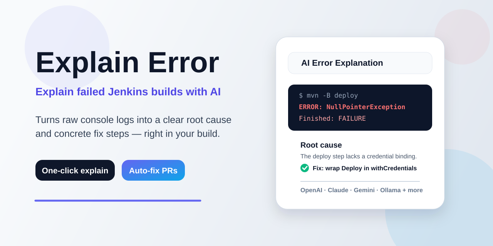
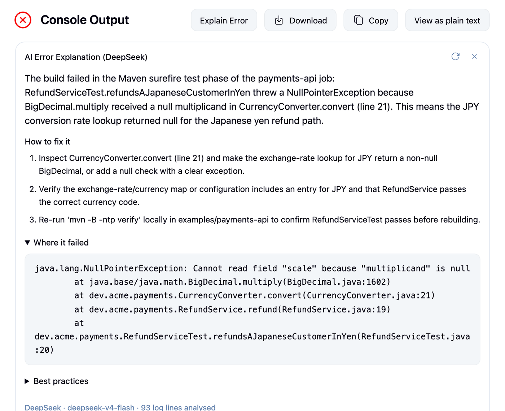
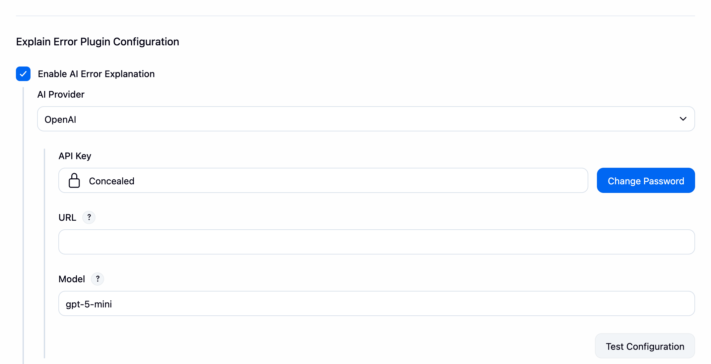
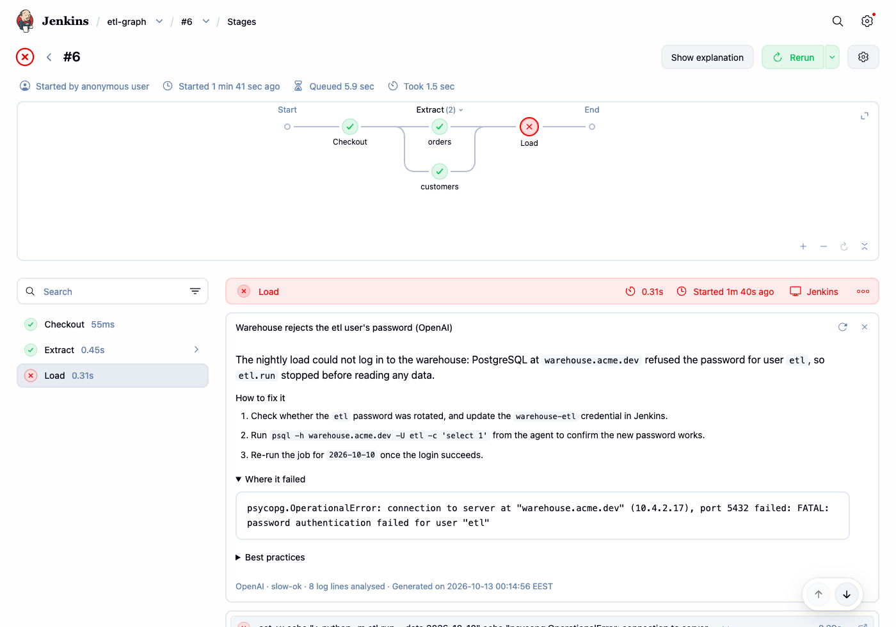
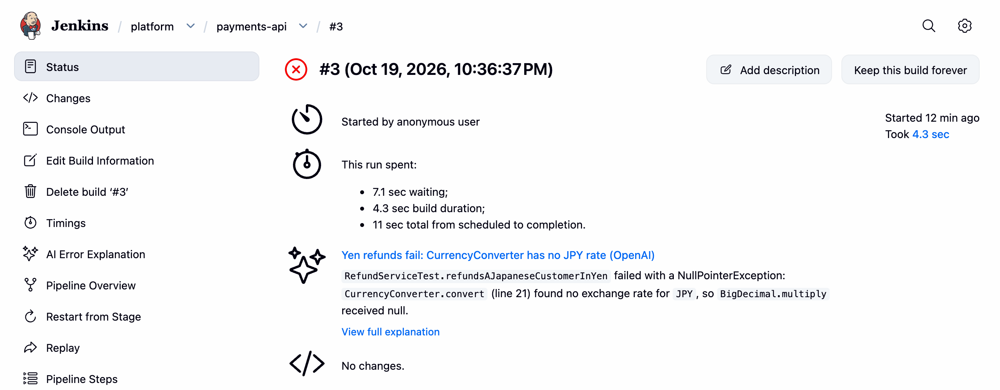

[](https://plugins.jenkins.io/explain-error/releases/)
[](https://ci.jenkins.io/job/Plugins/job/explain-error-plugin/job/main/)
[](LICENSE.md)

---

Explain Error turns a failed Jenkins build into a short explanation: what broke, why, and how to fix it. It reads the
log of the step that failed, asks the AI provider you choose, and shows the answer on the build, so nobody has to dig
through a long console to find the one line that matters.



🎥 [Watch the 90-second overview on YouTube](https://youtu.be/3dwNNoYePE0)

## Features

- **Explain Error button** on the console page of a failed build, and for each stage on the Stages page of
  [Pipeline Graph View](https://plugins.jenkins.io/pipeline-graph-view/)
- **`explainError()` Pipeline step** that returns the explanation as text or as a map of fields, for notifications and
  routing
- **Automatic explanation** of every failed build, with no pipeline change, within hourly and concurrency limits
- **Twelve AI providers**: Anthropic (Claude), AWS Bedrock, Azure OpenAI, Custom Okta AI, DeepSeek, Google Gemini,
  LangGraph Platform, Microsoft Foundry, Ollama, OpenAI, OpenAI Compatible (LiteLLM, OpenWebUI and other gateways) and
  Qwen, including private endpoints, company gateways and models you host yourself
- **Folder settings**, so each team can use its own provider, language and instructions
- **Request quotas and usage metrics** to keep provider costs in check
- **AI auto-fix** *(experimental)*: opens a pull request on GitHub, GitLab or Bitbucket with a proposed fix

## Getting started

Requirements: Jenkins 2.528.3 or newer, and an AI provider you can reach from the controller.

1. Install **Explain Error** from **Manage Jenkins → Plugins → Available plugins**. Without internet access, download
   the `.hpi` from the [releases](https://plugins.jenkins.io/explain-error/releases/) and upload it under
   **Plugins → Advanced settings → Deploy Plugin**.
2. Open **Manage Jenkins → System** and find **Explain Error Plugin Configuration**.
3. Choose an **AI Provider**, and fill in its key, endpoint and model.
4. Click **Test Configuration**, then **Save**.



The same with [Configuration as Code](https://plugins.jenkins.io/configuration-as-code/):

```yaml
unclassified:
  explainError:
    aiProvider:
      openai:
        apiKey: "${OPENAI_API_KEY}"
        model: "gpt-5-mini"
    enableExplanation: true
```

[AI Providers](docs/providers.md) lists the fields and an example for each provider, and
[Configuration](docs/configuration.md) describes every setting, folder overrides included.

## Getting an explanation

### On the console page

Open the console of a failed build and click **Explain Error**. The explanation opens above the log, as in the picture
at the top: a title that names the root cause, a summary, the steps to fix it, the log lines where it failed and, when
there are any, practices that would have prevented it. It reads up to 200 lines of the step that failed.

Once a build has an explanation, the button reads **Show explanation**, and the card says when the explanation was
generated; the re-explain icon asks the provider again. If a request fails, the card stays open with what went wrong
and a **Try again** button.

Asking for a new explanation needs the **Job/Build** permission, because it calls the AI provider. Users who can only
read the job see the explanation a build already has, and no button when it has none. The same applies on the Stages
page.

### On the Stages page

With [Pipeline Graph View](https://plugins.jenkins.io/pipeline-graph-view/), the same button is on the **Stages** page
of a failed Pipeline build, called **Pipeline Overview** before Pipeline Graph View 777. It explains the stage, parallel branch or step selected
in the graph from that node's log only, and shows the explanation above the node's steps. A node that passed has no
button.



A build keeps one explanation. Explaining another node replaces it, also on the build page and the console page; going
back to a node the explanation covers shows it again without asking the provider.

### In a Pipeline

Call `explainError()` where the build has already failed:

```groovy
post {
    failure {
        script {
            def explanation = explainError()
            slackSend(color: 'danger', message: "Build failed!\n\nAI analysis:\n${explanation}")
        }
    }
}
```

The step can read more lines, filter them with a pattern, include downstream builds and workspace files, or return a
map of fields with `returnStructured: true`. See [The explainError Pipeline Step](docs/pipeline-step.md).

### Automatically

Check **Automatically explain failed builds** in the global configuration, and every build that ends in `FAILURE` is
explained as soon as it completes, without any pipeline change. At most 30 provider calls an hour go to automatic
explanations by default, two run at a time, and a build that fails the same way as the last explained build of its job
reuses that explanation. A job can opt out, or opt in while the global toggle is off. See
[Automatic Explanation of Failed Builds](docs/auto-explain.md).

## Where explanations appear

The build page shows the title and the summary, with a link to the whole explanation; the full page is under **AI Error
Explanation** in the build's sidebar.



The explanation's fields are also available through the REST API at `<build-url>/error-explanation/api/json`.

## AI auto-fix *(experimental)*

With `explainError(autoFix: true, autoFixCredentialsId: '...')`, the plugin also asks the AI for a code change, commits
it to a new branch and opens a pull request for your review. It is opt-in and never merges anything. AI-generated
changes can be wrong, so review them like any other contribution. See [AI Auto-Fix](docs/auto-fix.md) for the setup,
the supported SCM services and the files it may change.

## Documentation

| Page | What it covers |
|---|---|
| [AI Providers](docs/providers.md) | Every provider's fields, models and Configuration as Code example |
| [Configuration](docs/configuration.md) | Global, folder and job settings, and Configuration as Code |
| [The explainError Pipeline Step](docs/pipeline-step.md) | Parameters, return values, downstream builds, workspace files |
| [Automatic Explanation](docs/auto-explain.md) | Explaining every failed build, its limits and per-job overrides |
| [AI Provider Call Quotas](docs/usage-quota.md) | Request quotas, metrics and dashboards |
| [AI Auto-Fix](docs/auto-fix.md) | Pull requests with AI-proposed fixes |

## Troubleshooting

| Issue | What to check |
|---|---|
| No **Explain Error** button | The button appears on finished builds that did not succeed. Check that explanation is on, globally and for the job's folder, and that **Test Configuration** succeeds. On the Stages page it needs Pipeline Graph View 777 or newer. Asking for a new explanation needs the Job/Build permission |
| Authentication or rate limit errors | The key, the provider's quota and plan, and the plugin's own [request quota](docs/usage-quota.md) |
| **Test Configuration** fails | The connection diagnostics report under the error shows the proxy decision, DNS, TCP and HTTP probe; read it bottom-up to find the layer that fails, and include it when you report an issue |

For details, add a log recorder for `io.jenkins.plugins.explain_error` at level `FINE` under
**Manage Jenkins → System Log**.

## Support and contributing

- [GitHub Issues](https://github.com/jenkinsci/explain-error-plugin/issues) for bug reports and feature requests
- [Contributing Guide](CONTRIBUTING.md) if you'd like to help
- Found a security vulnerability? Please report it following the [Jenkins vulnerability reporting process](https://www.jenkins.io/security/#reporting-vulnerabilities); do not open a public GitHub issue

If you find the plugin useful, please ⭐ it on GitHub.

## License

Licensed under the [MIT License](LICENSE.md).
