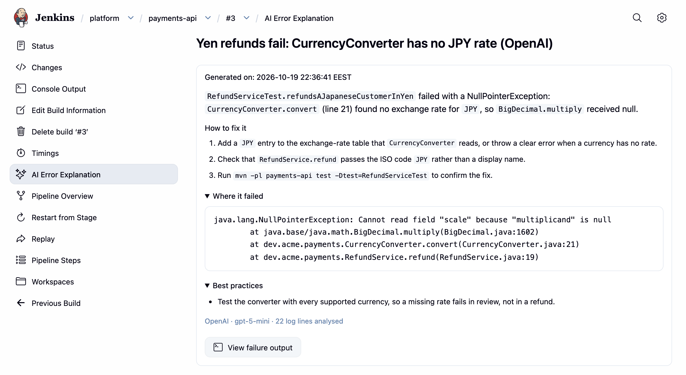

# The `explainError` Pipeline Step

`explainError()` explains the failure of the build it runs in. Call it where the build has already failed, usually in
a `post { failure { ... } }` block:

```groovy
pipeline {
    agent any
    stages {
        stage('Build') {
            steps {
                sh 'make build'
            }
        }
    }
    post {
        failure {
            explainError()
        }
    }
}
```

The explanation is saved to the build, as with the **Explain Error** button, and the step prints a link to it in the
console. The build page shows its summary, and the whole explanation is under **AI Error Explanation** in the build's
sidebar:



A failure to explain (explanation turned off, provider misconfigured, quota exceeded, provider error) is reported in the
console and never fails the build.

## Return value

The step returns the explanation as text, so a notification can carry it:

```groovy
post {
    failure {
        script {
            def explanation = explainError()
            slackSend(color: 'danger', message: "Build failed!\n\nAI analysis:\n${explanation}")
        }
    }
}
```

With `returnStructured: true` it returns a `Map` of the analysis instead, for a notification that shows only the root
cause, or for routing on the error signature:

```groovy
post {
    failure {
        script {
            def result = explainError(returnStructured: true)
            if (result) {
                slackSend(color: 'danger',
                          message: "Build failed: ${result.errorSummary}\n" +
                                   result.resolutionSteps.collect { "- ${it}" }.join('\n'))
            }
        }
    }
}
```

| Key | Type | Description |
|---|---|---|
| `title` | `String` | One-line title naming the root cause, at most about 70 characters (`null` if the provider returned none) |
| `errorSummary` | `String` | Root cause summary |
| `resolutionSteps` | `List<String>` | Ordered steps to resolve the error (empty if none) |
| `bestPractices` | `List<String>` | Recommendations to avoid recurrence (empty if none) |
| `errorSignature` | `String` | The log lines that identify the failure |
| `explanation` | `String` | The full rendered explanation, identical to the default return value |

Both forms return `null` when no explanation could be generated. The same fields are stored on the build and exposed
through the REST API at `<build-url>/error-explanation/api/json`.

## Parameters

| Parameter | Description | Default |
|---|---|---|
| `maxLines` | Log lines to analyze: the last lines of the failing steps, or of the console when no step's log can be found. `0` or less means the default | `100` |
| `logPattern` | Regular expression, matched without regard to case; only the lines it matches are sent. It filters the `maxLines` lines that were read, so raise `maxLines` when the lines you want are further back | `''` (no filtering) |
| `language` | Language of the explanation, e.g. `'English'`, `'中文'`, `'日本語'` | The folder or global setting |
| `temperature` | Model temperature (0.0–2.0) | The folder or global setting |
| `customContext` | Additional instructions for the AI. Overrides the folder and global Custom Context | The folder or global setting |
| `collectDownstreamLogs` | Include the logs of failed downstream builds started with the `build` step | `false` |
| `downstreamJobPattern` | Regular expression matched against the full names of downstream jobs; only matching jobs are read | `''` (none) |
| `includeWorkspaceContext` | Include selected files from the workspace | `false` |
| `workspaceContextPaths` | Comma-separated paths or glob patterns of the files to include | `pom.xml,build.gradle,build.gradle.kts,package.json,Jenkinsfile,Dockerfile,*.yml,*.yaml,*.properties` |
| `workspaceContextMaxBytes` | Maximum total bytes of workspace files to include; each file is cut to 8,000 bytes | `20000` |
| `returnStructured` | Return a `Map` of the analysis instead of the text | `false` |
| `autoFix` and `autoFix*` | Open a pull request with an AI-generated fix. See [AI Auto-Fix](auto-fix.md) | `false` |

```groovy
explainError(
    maxLines: 500,
    logPattern: '(?i)(error|failed|exception)',
    language: '中文',
    customContext: '''
        This is the payment service. If deployment fails, check the PCI compliance requirements
        and contact the security team about certificate issues.
    '''
)
```

## Downstream builds

When a build fails because a job it started with the `build` step failed, opt in to send that job's log too, and name
the jobs to read with a regular expression:

```groovy
explainError(
    collectDownstreamLogs: true,
    downstreamJobPattern: 'team-folder/.*/deploy-.*'
)
```

Only downstream jobs whose full name matches `downstreamJobPattern` are read, which keeps the step fast on large
controllers. A downstream build that called `explainError()` itself contributes its explanation instead of its log.
Downstream builds are followed up to five levels deep, and those the build's user cannot read are left out.

## Workspace context

Selected files from the workspace can help the AI, for example the build file whose dependency failed to resolve:

```groovy
explainError(
    includeWorkspaceContext: true,
    workspaceContextPaths: 'pom.xml,Jenkinsfile,src/test/**/*.java',
    workspaceContextMaxBytes: 30000
)
```

The files matching `workspaceContextPaths` (the default list when it is empty) are read, each cut to 8,000 bytes.
Paths are skipped when the file name starts with `.env`, `credentials` or `secrets`, or when they lie under `.git/`,
`.gradle/`, `target/`, `build/`, `dist/` or `node_modules/`, and absolute paths and `..` are refused. The files are sent
to the AI provider, so leave out any that hold secrets.

The files travel with the step's `customContext`. While `includeWorkspaceContext` is on and the step sets no
`customContext`, the folder and global Custom Context are not sent; set `customContext` on the step to keep them.
